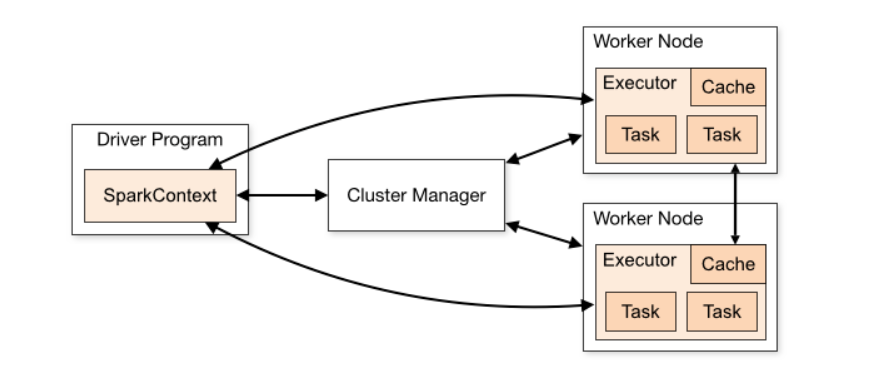
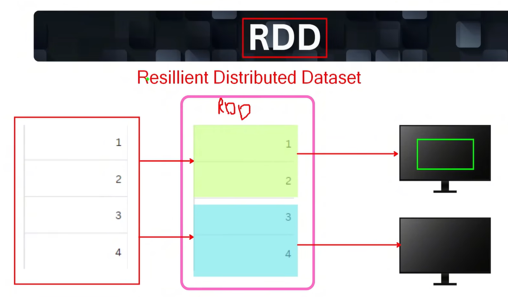
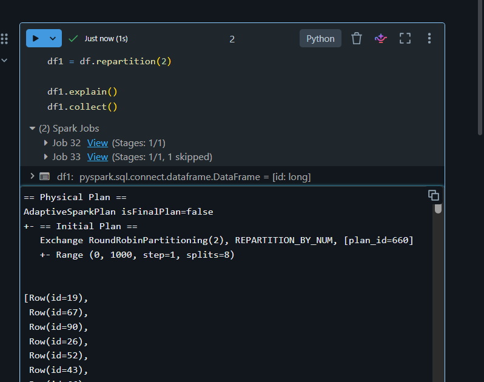
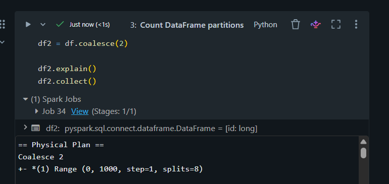

# Apache Spark — Fundamentals and Hands-on PySpark Notebooks

Practical Apache Spark concepts with runnable notebooks, execution plans, and screenshots. Open any linked `.ipynb` file below on GitHub to preview it, or import it into Databricks to run it.


## 1. Spark architecture

Spark divides data into partitions and processes them across executors. This allows different parts of the same dataset to be worked on at the same time.

There are four main components:

| Component | What it does |
|---|---|
| Driver | Runs the application code, plans the work and assigns tasks. |
| Cluster manager | Allocates the resources needed by the application. Examples include standalone, YARN and Kubernetes. |
| Worker node | The machine where executor processes run. |
| Executor | Processes the assigned data and holds cached data and intermediate results. |



When an application is submitted using `spark-submit`, it requests resources for the work. The driver coordinates the application, and the cluster manager provides resources for executors. Once the executors are available, the driver sends them tasks and receives their progress and results.

For example, if the code filters orders and then joins them with customer details, the driver coordinates that work. The executors read their assigned data and carry out the processing. A worker node and an executor are different: the worker is the machine, and the executor is a process running on it. An executor can handle multiple tasks at a time, depending on the resources available.

## 4. Lazy evaluation and actions

Spark does not process all the data as soon as a transformation is written. It first builds a plan of the operations needed. The computation runs when an action asks for a result. This is called lazy evaluation.

The [lazy evaluation notebook](01-lazy-evaluation-and-actions.ipynb) uses three records: Alice, Bob and Charlie. It filters for New York, selects the city column and then counts the rows.

```python
df_new = df_new.filter(col("city") == "New York")
df_new = df_new.select("city")
df_new.count()
```

The first two lines build the plan. The last line asks Spark to execute the work and returns **1**, because only Alice's record matches the filter. Waiting until the action lets Spark consider the filter and column selection together before running them.

`show()`, `collect()` and writing data are also actions. In Databricks, `display()` requests results as well. One detail to remember is that `collect()` brings all the result rows to the driver, so it should be used carefully with large datasets.

Although the names look similar, `df.count()` and `df.groupBy(...).count()` behave differently. The first returns a row count. The second creates an aggregated DataFrame that still needs an action to produce its results.

## 6. Spark RDD and partitions

RDD stands for **Resilient Distributed Dataset**. It is a collection of records divided into partitions that can be processed across executors.

For a large dataset, partitions give Spark smaller pieces of work to distribute. Each task processes its assigned partition, allowing several parts of the dataset to be processed in parallel.

The name describes three properties:

- **Resilient:** lost partitions can be rebuilt using the recorded steps, provided the required inputs are still available.
- **Distributed:** the work can be spread across different machines.
- **Dataset:** the collection of records being processed.

RDDs are immutable, meaning their contents are not changed in place. Applying a transformation creates a new RDD. Reusing a variable name can make this easy to miss. For example, `df = df.filter(...)` assigns the transformed DataFrame back to `df`; it does not edit the original DataFrame.

Spark keeps track of the dependencies between operations. This is called lineage, and those dependencies form a DAG, or directed acyclic graph. If a result partition is lost, Spark can follow these steps to recompute it. It does not need to keep every intermediate result in memory for this recovery to work.



## 7. Narrow and wide transformations

The difference comes down to whether an operation needs data from other partitions.

A **narrow transformation** can work within the existing partitions. For example, `filter()` can check each record independently, and `select()` can pick the required columns without consulting another partition.

Think of data split between two sheets. Each sheet can filter its own New York records. But if the requirement is total sales for New York, the amounts from both sheets need to be combined. That is the idea behind a **wide transformation**. Data moves between partitions so that matching keys can be processed together. This movement is called a shuffle, and it adds network and possibly disk work.

The [transformations notebook](02-transformations.ipynb) starts with IDs 0 to 11 in four partitions. It compares `filter()` and `select()` with `repartition(2)` and a grouped count on `id % 3`.

The final grouped count uses the original 12 rows, giving **4 rows each** for groups 0, 1 and 2. The earlier filter is a separate example. The notebook disables AQE and sets shuffle partitions to four so the execution is easier to follow.

## 8. Repartition vs. coalesce

Both operations change the number of partitions, but they do different amounts of work.

`repartition()` redistributes records through a shuffle. It can increase or decrease the partition count and is useful when the data needs to be spread out again. `coalesce()` combines existing partitions into fewer partitions without a full shuffle. It can reduce the count, but cannot increase it.

The [repartition and coalesce notebook](03-repartition-vs-coalesce.ipynb) starts with 1,000 rows in eight partitions:

```python
df = spark.range(1000, numPartitions=8)
df1 = df.repartition(2)
df2 = df.coalesce(2)
```

Both results contain the same rows in two partitions. With `repartition(2)`, Spark redistributes the records. With `coalesce(2)`, it combines the existing partitions. The plans show this difference through `Exchange` and `Coalesce`.

Coalesce can save work when fewer partitions are enough, but it may leave the work unevenly distributed. Reducing the count too far also leaves fewer tasks to run in parallel. Repartition can be worth the shuffle cost when a better distribution is needed, even when reducing the number of partitions.

### Execution plan screenshots

**Repartition — data is redistributed through a shuffle:**



**Coalesce — partitions are combined without a full shuffle:**



## 9. Jobs, stages and tasks

When an action requests a result, Spark starts the work as one or more jobs. Each job is divided into stages, and each stage runs tasks over its partitions.

In the jobs and stages example, the code filters for Sneakers, selects the order and product columns, and counts the orders by product. The filter and selection can run together because they work within the existing partitions. The grouped count needs to combine matching product values, so it introduces a shuffle boundary between stages.

Tasks before the shuffle prepare the data. Tasks after it read the shuffled results and finish the aggregation. The number of tasks relates to the partitions being processed in a stage, rather than the number of lines in the code.

[Notebook 04](04-jobs-stages-tasks-step-by-step.ipynb) puts the steps in separate cells, while [notebook 05](05-jobs-stages-tasks-combined.ipynb) combines them. Both produce **Sneakers: 3** with the built-in sample. Moving the code into one cell does not remove the shuffle or change what the calculation needs to do.

After running the action, the Spark UI can be used to open the job and inspect its stages and tasks.

## 10. Shuffle joins

To join two tables, Spark needs to bring matching keys together. In a shuffle join, rows from the inputs are redistributed into corresponding partitions using the joining key. For example, transactions for a customer need to reach the partition where they can be matched with that customer's details. Different keys can still share a partition.

After the shuffle, the join can be performed in different ways:

- **Sort-merge join:** sorts the inputs within each partition by the joining key, then moves through the sorted records to find matches.
- **Shuffled-hash join:** builds a hash lookup table from one input within each partition, then looks up matching keys from the other input. This avoids sorting, but the hash table needs enough memory.

The [joins notebook](06-shuffle-and-broadcast-joins.ipynb) uses one million transactions and 100 customers, joined on `customer_id`. Automatic broadcasting and AQE are disabled, with shuffle partitions set to eight.

The normal join is inspected using `explain("formatted")` to see which strategy Spark selects. Every transaction has one matching customer, so the expected result is **1,000,000 rows**.

## 11. Broadcast joins

When one table is small, Spark can send a copy of it to the executors. Each executor then has the lookup data needed to join with its partitions of the larger table. This avoids redistributing the large table for the join.

In the same notebook, the customer table is the small side:

```python
broadcast_join = transactions.join(broadcast(customers), "customer_id")
broadcast_join.explain("formatted")
broadcast_join.count()
```

Each executor can match its transaction records against the customer lookup. The expected count is still **1,000,000**; the change is in how Spark performs the join. The plan should show `BroadcastHashJoin` and `BroadcastExchange` for this example.

The driver helps prepare and distribute the broadcast, so the small table must fit comfortably in both driver and executor memory. Broadcasting a large table can create memory problems instead of improving performance.

The explicit `broadcast()` hint requests this strategy even though automatic broadcasting is disabled in the notebook. The final `count()` may still need an exchange to combine counts, so an exchange elsewhere in the plan does not mean the broadcast join failed.

## 18. Caching

Displaying a DataFrame once does not automatically save its result for later use. If another action needs the same data, Spark may repeat the steps used to produce it. Caching allows that computed result to be kept and reused.

The [baseline notebook](07-caching-baseline.ipynb) creates five rows, adds `Flag = "Yes"` and filters for Alice. Without caching, a later query can repeat the work that creates the Flag column, even though the earlier DataFrame was already displayed.

The [caching notebook](08-caching-execution.ipynb) caches the original five-row DataFrame before filtering for Alice. It does not add the Flag column. These examples help show how reuse appears in the plan; they are not a timing comparison of identical operations.

Calling `cache()` marks the DataFrame for caching. The data is stored as an action computes it. In the notebook, the first `display(df1)` happens before `cache()`, so that display does not populate the cache. To load the full result into the cache before using it again:

```python
df1.cache()
df1.count()

df2 = df1.filter(col("id") == 1)
df2.show()
df2.explain("extended")

# Release the cached data when finished.
df1.unpersist()
```

`InMemoryTableScan` or `InMemoryRelation` in the plan indicates the cached relation. The Storage tab shows how many partitions are cached and how much space they use in memory or on disk.

Caching is useful when the same result is needed several times and would otherwise take time to recompute. For data used only once, the extra storage usually adds little benefit. Once the repeated work is finished, `unpersist()` releases the cached blocks.

## References

- [Spark cluster architecture](https://spark.apache.org/docs/latest/cluster-overview.html)
- [RDD programming guide](https://spark.apache.org/docs/latest/rdd-programming-guide.html)
- [Query plans and EXPLAIN](https://spark.apache.org/docs/latest/sql-ref-syntax-qry-explain.html)
- [Coalesce API](https://spark.apache.org/docs/latest/api/python/reference/pyspark.sql/api/pyspark.sql.DataFrame.coalesce.html)
- [SQL performance tuning and joins](https://spark.apache.org/docs/latest/sql-performance-tuning.html)
- [Join and partition hints](https://spark.apache.org/docs/latest/sql-ref-syntax-qry-select-hints.html)
- [DataFrame caching](https://spark.apache.org/docs/latest/api/python/reference/pyspark.sql/api/pyspark.sql.DataFrame.cache.html)
